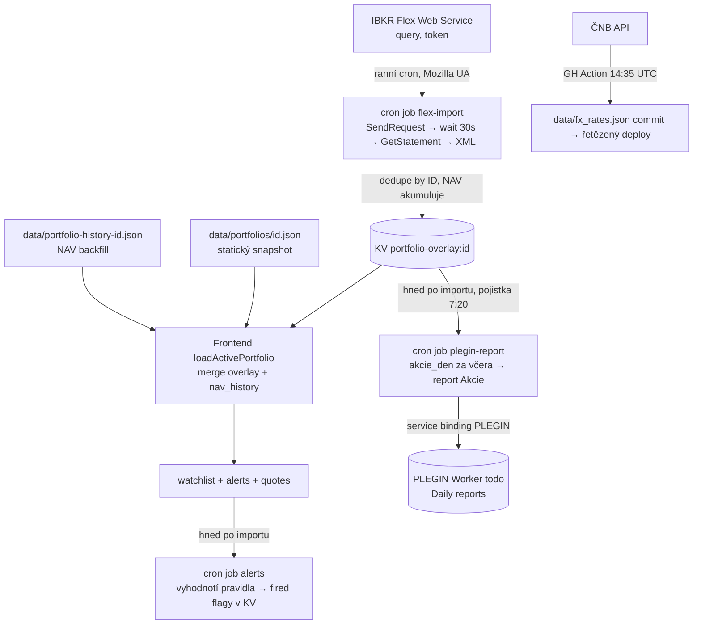

# CLAUDE.md — akcie-tracker

> Aktualizováno 2026-10-28 (tab Daňová optimalizace – zadání PLEGIN #7; ranní report Akcie
> do PLEGINu posílá Worker sám – PLEGIN_ZADANI_01;
> 2026-09-23 MCP konektor pro PLEGIN + sdílený výpočet portfolia; Celkový
> výnos z toků kapitálu + XIRR, výběry KB doplněny; migrace
> Pages → jeden Worker 2026-07-23; revize kódu 2026-07-22 viz `REVIZE_REPORT.md`). Jediný projektový brief pro Claude (Cowork i Claude Code ho čtou
> automaticky). Obecná pravidla (`OBECNA_PRAVIDLA.md`) se načítají automaticky.

---

## Stav projektu

**Účel:** Privátní portfolio tracker pro PLEGI invest — dva brokery (Interactive
Brokers + Komerční banka), do budoucna další. Slouží zároveň jako evidenční podklad
pro účetnictví — transakční log + report v CZK + XLSX exporty.

**Stack:** Statické HTML + vanilla JS ES modules, žádný framework, žádný build krok,
žádný TypeScript. Backend = **jeden CF Worker `akcie-tracker`** (statické assety + `/api/*`
+ denní cron v jednom, entry `worker/index.js`) + **1 GitHub Actions workflow**
(denní ČNB kurzy). Cloudflare KV namespace `AKCIE_TRACKER_KV`
(ID `6d78ccbecdc64d7e9798f1ed39fca35d`) s bindingem ve Workeru.

**Hosting:**
- **Worker `akcie-tracker`** — `https://akcie-tracker.lukas-pleskot.workers.dev/`
  (push do `main` → **Workers Builds**, CF git integrace → `npx wrangler deploy`;
  web, API i crony v jednom)
- **Ranní cron** `0 5 * * *` UTC = **7:00 Prahy v létě / 6:00 v zimě**
  (vědomý DST drift, rozhodnutí 2026-07-25): flex-import, hned po něm ranní report
  Akcie do PLEGINu a vyhodnocení alertů nad čerstvým overlay (`runDailyJobs` ve
  `worker/index.js`). **Pojistka reportu** `20 5,6 * * TUE-SAT` = 7:20 Prahy v létě
  i v zimě (kód pustí jen ten UTC čas, kdy je v Praze 7:xx) – viz „Ranní report do PLEGINu".
- Bývalý Pages projekt a samostatné Workery `akcie-tracker-cron` +
  `akcie-tracker-flex-import` jsou zrušené (migrace 2026-07-23/25). Účet od
  2026-07-25 **Workers Paid** (free měl account limit 5 cron triggerů).

**Přístup:** ✅ **Cloudflare Access AKTIVNÍ od 2026-07-25** (uzavírá R1 z revize
2026-07-22). Zapnuto na workers.dev (Worker → Settings → Domains & Routes →
Enable Cloudflare Access), politika Allow e-mail `lukas.pleskot@chrudim.cz`.
Ověřeno anonymním curl: `/`, `/data/*`, `/api/*` i `/run/*` → 302 na
`lpleskot.cloudflareaccess.com`. Crony běží Accessem nedotčené (žádné HTTP přes
vlastní doménu — ASSETS binding). Manuální `/run/*` přes curl vyžaduje Access
**service token** (Zero Trust → Service Auth) NAVÍC k `x-admin-key` — nebo
prostě počkat na ranní cron. Druhá vrstva ochrany: `noindex` + `robots.txt`.
**Výjimka `/mcp`** (MCP konektor pro PLEGIN, 2026-09): samostatná Access aplikace
pro cestu `/mcp` s politikou **Bypass** — ověřuje až Worker tokenem `MCP_TOKEN`.
Zbytek webu dál za Accessem (ověřit anonymním curl: `/` a `/api/*` → 302, `/mcp` → 401).

**Repo:** `lpleskot/akcie-tracker` (private, GitHub). **Git root je subfolder `web/`**,
ne kořen projektu — `workers/`, `.github/`, `scripts/` musí být **uvnitř** `web/`,
jinak se nedostanou do repa.

---

## Klíčová architektonická rozhodnutí

- **Source of truth = pole transakcí + cash_flows**, ne uložené pozice. FIFO se počítá v runtimu.
- **FIFO** s prorataovanou komisí do cost basis (BUY) i do net výnosu (SELL) per kus.
- **Jedno portfolio = jeden JSON soubor** v `data/portfolios/`. `manifest.json` listuje
  dostupná portfolia (`plegi-invest-ibkr` primary, `plegi-invest-kb`).
- **Multi-portfolio:** `state.portfolioId`, selector v hlavičce, localStorage memory.
  Při přepnutí: reload portfolio JSON + recompute FIFO + refresh Yahoo ceny.
  **Watchlist + Alerty + Notes + Deník = globální** (cross-portfolio).
- **Hybridní data model:**
  - **Statický JSON** v gitu = historický snapshot, manuálně commitnutý
  - **KV overlay** = denní auto-import přes IBKR Flex (Worker `flex-import` → KV `portfolio-overlay:{id}`)
  - `mergeOverlayIntoPortfolio()` (`portfolio-shared.js`, volá frontend i Worker) přidává overlay eventy ke statickému JSON,
    dedupe podle `flex_id` (= IBKR `tradeID` / `transactionID` / `actionID`)
- **Účetně rozhoduje datum VYPOŘÁDÁNÍ (settle_date)**, ne datum obchodu — určuje rok
  i kurz ČNB. Prodej s obchodem 30.12. a vypořádáním 2.1. patří do nového roku.
  Platí pro: Report pro účetní (rok chips, FIFO párování, kurzy), export Reportu,
  export Transakcí pro účetní. FIFO closed lots nesou `buy_settle_date` + `sell_settle_date`;
  **Flex overlay trades nesou `settle_date` z `settleDateTarget`** (doplněno 2026-07-25 —
  bez toho report u auto-importů tiše používal datum obchodu). Tab Transakce (obrazovka)
  zůstává na datu obchodu. `fx_rates.json` pokrývá settle data všech transakcí.
- **Yahoo historické ceny jsou split-adjusted** (staré close přepočtené na dnešní počet
  kusů). Kdekoli se oceňuje k minulému datu, je nutné cenu vynásobit `splitFactorAfter()`
  (součin poměrů splitů po datu z corporate actions). Inventura k datu to dělá; kdo přidá
  další historické ocenění, musí taky.
- **Yahoo Finance** přes neoficiální `query1.finance.yahoo.com`, voláno ze serveru
  (CF Function `/api/quote`), cache 60 s, MINOR_UNITS scale (GBp/100, ZAc/100 atd.).
  Historická řada (`fetchYahooCloseAt`, period1/period2) má ráno po obchodním dni
  u US a evropských burz bar za včerejšek ještě s `close: null` (zjištěno 2026-09-23
  ve 4:45) — závěr posledního dne se proto doplní z `meta.regularMarketPrice/Time`,
  bar z řady má přednost. `chartPreviousClose` NENÍ předchozí závěr (je to závěr
  před začátkem stahovaného okna).
- **ČNB kurzy** v `data/fx_rates.json` — denní fetch přes GH Action `fx-update-cron.yml`
  (14:35 UTC). `getFxToCzk(date, ccy)` je strict by default (vrátí null pokud chybí),
  opt-in `{ allowFallback: true }` použije nejbližší předchozí. Důležité pro daňový
  report — žádné vymýšlení kurzů. Skript je **fail-fast**: při chybě fetche nejde dál
  (exit 1 → červený workflow), aby za dírou nevznikl trvale přeskočený den.
- **Sdílené moduly místo kopií** (R5/R6): FIFO engine `assets/js/fifo.js` (vč.
  `positionTotalReturn` = sloupec Celkem Z/Z), Flex transformace `assets/js/flex-shared.js`
  a **`assets/js/portfolio-shared.js`** (merge overlay `mergeOverlayIntoPortfolio`,
  kurzy `fxToCzk`/`amountToUsd`, hotovost `cashToCzk`, toky kapitálu `capitalFlowsUsd`,
  Celkový výnos `portfolioTotalReturn` + `xirrPct` — kurzy parametrem, žádný globální
  stav) importuje frontend,
  cron job alerts i MCP konektor (wrangler/esbuild je při deployi zabalí).
  **Kdo potřebuje číslo, které appka ukazuje, volá tyhle funkce — žádné kopie vzorců**
  (export XLSX přehledu měl vlastní kopii Total Return bez dividend, opraveno 2026-09).
  `worker/api/lib.js` = Yahoo fetch (minor units!), `fetchAssetJson` (ASSETS binding)
  + JSON helper. Jeden Worker = vše se deployuje najednou, žádné path-based redeploye.
- **Vendorovaný XLSX** `assets/js/vendor/xlsx-js-style.min.js` — **xlsx-js-style 1.2.0**
  (fork SheetJS 0.18.5 se zápisem stylů buněk; nahradil SheetJS mini 0.20.3 dne
  2026-07-25 kvůli barvám v exportu Reportu). Používáme JEN zápis — čtecí CVE SheetJS
  (prototype pollution / ReDoS při parsování cizích sešitů) se nás netýkají, žádné
  soubory nečteme. Mimo npm audit — kontrolovat ručně při revizi (zdroj: npm xlsx-js-style).

### Yahoo ticker mapování
- Manuální mapa v `instruments[<sym>].yahoo_symbol`. US tituly bez přípony, ostatní
  s burzovní příponou (`.TO`, `.ST`, `.PA`, `.DE`, `.AS`, `.AX`, `.WA`, `.MI`, `.L` …).
- **Auto-přidané instrumenty z Flex overlay** (funkce `ensureInstrument` ve `flex-shared.js`)
  odvozují příponu z IBKR `listingExchange` přes mapu `IBKR_EXCHANGE_SUFFIX`
  (`deriveYahooSymbol`): `AEB→.AS`, `SBF→.PA`, `IBIS→.DE`, `SFB→.ST`, `TSE→.TO`, …
  Bez toho Yahoo napáruje holý symbol (např. „CSG") na cizí US titul a vrátí null cenu.
  Neznámá burza → symbol beze změny (fallback); doplnit do mapy podle potřeby.
- **Forex konverze NEJSOU pozice.** IBKR při nákupu titulu v cizí měně automaticky
  převádí měnu a účtuje forex trade (`assetCategory="CASH"`, symbol `BASE.QUOTE`
  jako `EUR.USD`, `USD.DKK`). `mergeOverlayIntoPortfolio` je přes `isForexConversion()`
  vyřazuje z transakcí/pozic a účtuje je jako **oboustrannou konverzi cashe**
  (base měna ← `quantity`, quote měna ← `netCash`).

---

## Daily data flow



- **flex-import**: 2-call flow (SendRequest → wait 30s + retry → GetStatement → XML).
  **Používá Mozilla UA** — IBKR WAF blokuje bot-like UA na CF edge IP (403).
  Parsuje: Trade, CashTransaction, CorporateAction, Transfer, OpenPosition,
  EquitySummaryByReportDateInBase (NAV), MTMPerformanceSummaryUnderlying (YTD M2M);
  XML entity v atributech se dekódují. Merge dedupe by ID; **NAV snapshot AKUMULUJE
  by reportDate — nepřepisovat!** KV se ukládá i když přibyly JEN nové NAV dny (R3 —
  jinak by klidné dny mizely z grafu; Flex okno je ~7 dní). Manuální `/run/flex-import`
  vyžaduje header `x-admin-key` = secret `ADMIN_KEY`. Při selhání loguje (bez e-mailu);
  nepřímý signál = žlutý banner v UI, když overlay zestárne >4 dny (R7). Secrets:
  `FLEX_TOKEN`, `ADMIN_KEY`; var `FLEX_QUERY_ID` (1514926), `DRY_RUN` pro test bez zápisu.
  **Údržba overlay (~1× ročně):** overlay v KV roste donekonečna — promítnout obsah do
  statického portfolio JSON (commit) a overlay klíč smazat; další import začne načisto.
- **alerts**: čte watchlist + alerts + **portfolio-overlay přímo z KV**, statický
  portfolio JSON přes **ASSETS binding** a ceny přímo sdílenou `fetchYahooQuote` —
  žádné HTTP přes vlastní doménu, Cloudflare Access se jobu netýká. Overlay merguje
  sdíleným `mergeOverlayIntoPortfolio` (stejný jako frontend) a FIFO počítá sdíleným
  enginem (`fifo.js`) — vidí tedy i pozice z auto-importu (R6). **Bez notifikací** — e-maily (Resend) odstraněny
  2026-07-23; splněná pravidla zapíše jako `fired:*` flagy a UI je zobrazí v tabu
  Alerty (deduplikace: fired pravidlo se znovu nevyhodnotí do manuálního Re-arm).
  Selhání jobu je vidět jen v CF lozích. Manuální `/run/alerts` s `x-admin-key`;
  `/run/alerts?dry=1` = vyhodnotí bez zápisu fired. Hlídá jen IBKR portfolio
  (`PORTFOLIO_ID`), KB pozice ne.
- **fx-update-cron**: `scripts/fx-update.mjs` fetchne ČNB pro chybějící dny,
  commit + push `data/fx_rates.json` (potřebuje `contents: write`). Push spustí
  deploy přes Workers Builds webhook — ten funguje i pro commity z `GITHUB_TOKEN`
  (na rozdíl od `on: push` GitHub workflows), takže se kurzy dostanou na web.

---

## Portfolia

### `plegi-invest-ibkr.json` (Interactive Brokers, account U23077136)
- **Zdroj:** IBKR Trade Confirmation (HTML, prvotní) + IBKR Activity Statement (CSV, backfill)
  + IBKR Flex Web Service (denní auto → KV overlay).
- Inception 2025-11-24. **48 statických transakcí** + průběžně přibývá Flex auto-import.
- Instrumenty na NASDAQ, NYSE, Stockholm, Toronto, Paris, Xetra, Amsterdam (nové přes Flex).
- 1 corporate action (BKNG 25:1 split 2026-04-06). FIFO shodné s IBKR na cent.
- `data/portfolio-history-plegi-invest-ibkr.json` — NAV backfill od inception
  (jednorázově `outputs/backfill_nav.py`: Activity Statement CSV + Yahoo historical close),
  obsahuje i `deposits[]`. Tolerance vs IBKR snapshot ~1,5 % (dividend accruals + FX rounding).

### `plegi-invest-kb.json` (Komerční banka, account 1609386)
- **Zdroj:** KB TRN CP (PDF) + KB TRN CASH (PDF) + KB STAV PTF (snapshoty).
- Období 2022-12-30 → 2026-09-30 (inception = synthetic).
- **47 instrumentů** v 9 měnách (USD, EUR, CAD, SEK, PLN, GBP, AUD, DKK, CZK).
- **144 transakcí:**
  - 14 synthetic pre-2023 openings ze STAV PTF 31.3.2023 (cost basis = tržní cena k datu,
    skutečná pre-2023 nákupní cena neznámá — starší KB výpisy v MiFID formátu bez transakčních dat).
  - 127 reálných BUY/SELL z TRN CP 2023–2026-Q3 (Q2 2026 bez obchodů). (Původních 7 synthetic Q2 2023 nahrazeno
    reálnými — Q2 2023 výpisy existují, jen jsou ve složce podkladů pod chybným názvem
    `Výpis 1.7.-30.9.2023-9.pdf` … `-12.pdf`.)
- **23 corporate actions** (Vklad/Výběr CP) — splity, rights issues, restructurings.
  Q1 2023 CAs filtrovány (`synthetic_cutoff_date = 2023-03-31`).
- **160 dividend** + 124 withholding tax, **129 cash flows** (vč. 10 výběrů `withdrawal`
  12/2025–7/2026 = převody na IBKR; 9 doplněno 2026-09-23 z TRN CASH, 59 800 USD 8. 7. 2026 z Q3).
- **Počáteční kapitál:** `opening_cash` (hotovost k 30. 12. 2022 z počátečních zůstatků
  výpisů Q1 2023) + 14 syntetických pozic. `total_deposits_usd` KB nemá — vklady, výběry
  i počáteční kapitál se počítají z evidence (`capitalFlowsUsd`). **Výběry i vklady se při
  kvartálním importu zapisují vždy** (typ `withdrawal` / `deposit`), jinak Celkový výnos lže.
- **Q2 2026 import** (dividendy/daně/externí CA poplatky z TRN CASH; žádné obchody — TRN CP Q2
  neexistuje): datum = **vypořádání (= připsání na účet)**, ne splatnost. Důkaz: HUYA dividenda
  (splatnost 01.07, vypořádání 30.06) je v Q2 výpisu a v zůstatku k 30.06. Poplatky za vedení
  účtu ("Poplatek za správu" + DPH) se **neimportují** (řeší účetní, nepromítají se do ceny akcií).
  **Celá historie přerovnána na vypořádání** (audit 2026-07 přes reparsing všech TRN CASH + 2023
  Výpisů): 74 záznamů (2023–2026-Q1) posunuto o 1–5 dní, **žádná změna daňového roku**, celkový
  FX dopad +534 CZK. Re-audit: 0 záznamů zbývá na datu splatnosti.
- **Q3 2026 import** (2026-10-04): 4 prodeje (ACN, CRST.L, GOOG, UNH), 5 dividend, 3 daně,
  1 výběr, 1 externí poplatek. **Settle u obchodů = „Datum vypořádání“ z TRN CP** (konvence všech
  importů). Pozor: TRN CASH u GOOG/UNH připsal peníze s vypořádáním 06.07., TRN CP uvádí 07.07.
  (US svátek 3. 7. + český svátek 6. 7.) — ponechán TRN CP; kdyby to účetní chtěla podle
  připsání, změnit `settle_date` obou prodejů na 2026-07-06 (kurz ČNB 21,13 místo 21,191).
- **14/14 otevřených pozic** match KB statementu (30.9.2026); hotovost 7 měn zrekonciliována na cent.
  KB ve STAV PTF oceňuje Canacol 0,75 CAD/ks (app ho jako delisted oceňuje 0). Validace vs Sharesight
  Sold Securities: 32/34 prodejů match (2 nesoulady = CNE 1890 ks Sharesight chyba, IPO 1 ks zaokrouhlení).
- **Delisted konvence** (`instruments[sym].delisted = "YYYY-MM-DD"`): CNE.TO (Canacol,
  TSX suspend 17.11.2025, CCAA). Frontend se neptá Yahoo a přiřadí syntetickou cenu 0
  (`{price: 0, delisted: true}`) — pozice se počítá do hodnot jako bezcenná, Přehled
  ukazuje badge „delisted", alerty (cron i UI náhled) ji přeskakují. Pozice zůstává
  otevřená — KB ji stále vede a daňová ztráta se realizuje až formálním odpisem.
  Dřívější delisted tituly (SMSI, SPCE, IPO.TO) jsou vyřešené: reverse splity spárované
  přes received/removed CA a zbytky doprodané → net_qty 0.

### `data/fx_rates.json`
- ČNB rates pro 12 měn, **448 dnů**: rok 2026 souvisle (backfill všech všedních dnů
  2026-07-25 — settle data Flex auto-importů padají kamkoliv), starší roky jen settle
  dny transakcí. Auto-update denně 14:35 UTC (`fx-update.mjs` — ČNB API `lang=EN`,
  `validFor` per-rate; forward-only od max data — **starší díry doplňovat ručně**,
  stejný entry formát, serializace `JSON.stringify(data, null, 2) + "\n"`, klíče
  chronologicky). Víkendy/svátky: API vrací poslední vyhlášené kurzy, ukládají se pod
  dotazované datum s `valid_for` = skutečný den vyhlášení (poslední vyhlášený kurz —
  účetně korektní).

---

## Frontend taby (v pořadí)

`overview` Přehled pozic · `transactions` Transakce · `dividends` Dividendy ·
`allocation` Alokace · `alerts` Alerty · `watchlist` Watchlist · `journal` Deník investora ·
`report` Report pro účetní · `tax` Daňová optimalizace · `positions-at` Pozice k datu ·
`portfolio-history` Hodnota portfolia

- **Přehled pozic:** expandable detail per pozice (nákupy/prodeje/FIFO matching/split/
  dividendy/Total Return + Poznámka), sloupce vč. **Nereal. Z/Z** (jen otevřené loty)
  a **Celkem Z/Z** (real + nereal + dividendy).
- **Transakce:** filter rok / custom date / search, **Export pro účetní** (CZK přepočet ČNB) jen tady.
- **Report pro účetní:** seskupený **per ticker** (abecedně, jedna karta na symbol) —
  uvnitř prodeje chronologicky, každý se svými FIFO matched nákupy a ziskem, dole
  mezisoučet za symbol (u více prodejů). CZK přepočet dle vypořádání, XLSX export
  (stejné seskupení, barevné řádky, kurz s datem) + tisk/PDF. Výpočet prodejů v Kč je
  sdílená `realizedSales()` (`portfolio-shared.js`) — obrazovka, export i Daňová
  optimalizace (refaktor 2026-10-28 ověřen proti původnímu kódu: 151 prodejů, 0 rozdílů).
- **Daňová optimalizace (od 2026-10-28, zadání PLEGIN #7):** za celou společnost (obě
  portfolia, nezávisle na aktivním). Dlaždice: **Realizováno <rok>** (prodeje vypořádané
  v aktuálním pražském roce = součet Reportu pro účetní za IBKR + KB), **Odhad daně z prodejů**
  (21 % DPPO jen z kladného výsledku prodejů), **Nerealizovaný zisk / ztráta** (jen pozice,
  které jdou prodat), **Simulace** (výsledek roku po prodeji zaškrtnutých pozic, nic se
  neukládá), **Dividendy <rok>** (hrubě + sražená daň v Kč, informace — samostatný základ).
  Tabulka per pozice a účet: pořizovací cena v Kč (otevřené FIFO loty × kurz ČNB
  k vypořádání každého nákupu — `openLotsCostCzk`, sdílené s Pozicemi k datu), hodnota
  v Kč (cena `/api/quote` × poslední kurz ČNB), Z/Z v měně (= Nereal. Z/Z v Přehledu)
  a **Z/Z v Kč (daňově)** — rozdíl je kurzový. Klik na řádek = držené nákupy (loty).
  Delisted (CNE.TO) jde vidět, ale do součtů ani simulace nejde (ztráta až odpisem).
  Čerstvý nákup s vypořádáním po posledním dni v kurzech dostane poslední kurz „odhadem".
  Výpočty `assets/js/tax-optimization.js` (čisté funkce, testy). **Daňový rámec
  (Lukáš 2026-10-28):** PLEGI invest je **mikro účetní jednotka** (0 zaměstnanců) →
  akcie se k 31. 12. nepřeceňují (§ 27 odst. 7 ZoÚ), do daně jde jen prodej a ztráta
  z prodeje je uznatelná (omezení § 24 odst. 2 písm. w) ZDP — nabývací cena jen do výše
  příjmu z prodeje — se na mikro ÚJ nevztahuje). Kdyby firma přestala být mikro (§ 1b
  ZoÚ: překročí 2 ze 3 hranic — aktiva 11 mil. Kč, čistý obrat 22 mil. Kč, 10 zaměstnanců),
  musela by akcie přeceňovat a bez přecenění by ztráty z prodeje uznatelné nebyly — pak
  tab přepočítat. **Výhrada v UI:** orientační výpočet, ne daňové poradenství; prodej
  s okamžitým zpětným nákupem jen kvůli dani může FÚ posoudit jako zneužití práva.
  XLSX: souhrn + pozice, filtr, data jako datum Excelu, Celkem = `SUMIFS` přes „Lze
  prodat". Ukotvenou hlavičku vendorovaná knihovna (SheetJS CE 0.18.5) zapsat neumí.
- **Pozice k datu (inventura):** stav pozic k rozvahovému dni **přes všechna portfolia**
  (načte obě z manifestu + overlay, nezávisle na aktivním) — název, ISIN, ticker, kusy,
  cena k datu, ocenění v měně i CZK, pořizovací cena CZK (FIFO loty × kurz k vypořádání),
  oceňovací rozdíl. Kusy = `computePositionsAt` (obchody **vypořádané** ≤ datum, CA ≤ datum).
  Cena = `/api/quote-at` (Yahoo close posledního obchodního dne ≤ datum, datum baru v pásmu
  burzy) **× `splitFactorAfter`** — Yahoo historie je split-adjusted, bez korekce by BKNG
  před splitem 1:25 vyšel 25× levněji. Kurz = `/api/fx-at` (ČNB živě, `valid_for`
  = poslední vyhlášený). Delisted (`instruments[sym].delisted` ≤ datum) → cena 0.
  XLSX export má v A1 doslovné znění požadavku auditora (`PA_TITLE_TEMPLATE`, {DATE}).
- **Hodnota portfolia:** NAV time-series (SVG chart), deposit markery, 3 emphasized globální
  dlaždice (Celkem vloženo / Aktuální hodnota / Rozdíl) + period dlaždice + tabulka per day.
- **Deník investora:** KV-backed text deník, inline editace, search.
- **Společné:** Search s ×, sort klikem na th, XLSX export per tab (SheetJS self-hosted).
  Summary dlaždice: Hodnota portfolia CZK (klik → Hodnota portfolia tab), Cash (multi-currency),
  Celkový výnos %, P.a., YTD, Dividendy (po dani).
- **Celkový výnos a P.a. (od 2026-09-23):** toky kapitálu z evidence (`capitalFlowsUsd`) =
  `opening_cash` + syntetické počáteční pozice (cost basis, kurz k vypořádání) + `cash_flows`
  typu `deposit`/`withdrawal` a Flex `Deposits/Withdrawals`, vše v USD kurzem ČNB k datu
  toku. `total_deposits_usd` jen jako fallback pro portfolio bez jakýchkoli toků.
  Zisk = hodnota + vybráno − vloženo; **% = zisk / vloženo** (výběry základ nezmenšují);
  **P.a. = XIRR** (peněžně vážený roční výnos, řeší vklady i výběry v čase). U IBKR (jen
  vklady) je % stejné jako dřív, P.a. se od prosté anualizace liší. Dřívější vzorec
  (hodnota − vklady) / vklady s neúplnými vklady dával KB +127 % / p.a. 24,6 %, správně
  je ≈ +43 % / XIRR ≈ 16,6 % (k 2026-09-23).

### Mobil (úpravy 2026-08-19, `styles.css`)

- **Ukotvené sloupce v tabulkách** (`@media max-width: 1024px` — schválně ne 768,
  ať platí i pro mobil na šířku): první sloupec je `position: sticky; left: 0`,
  takže při posunu doprava je pořád vidět, o který titul jde. Transakce a Dividendy
  mají první sloupec datum → ukotvený je **i symbol** (`left: 100px`, datum má proto
  pevnou šířku 100 px; sloupec Čas se na mobilu skrývá). Ukotvené buňky musí mít
  vlastní pozadí (surface / zebra / expanded), jinak pod nimi prosvítá projíždějící
  obsah. Řádky detailu (colspan) se vynechávají — místo toho je `.detail-card`
  sticky přes šířku viewportu, aby rozbalený detail zůstal v zorném poli.
- **`@media max-width: 768px`**: dlaždice 2 ve sloupci, taby se zalomí (dřív
  přetékaly → vodorovný scroll stránky), dotykové cíle ≥ 44 px (taby 42),
  inputy 16 px (jinak iOS zoomuje na focus).
- **Všechna `:hover` pravidla jsou v `@media (hover: hover)`** — na dotyku by jinak
  první ťuknutí jen „obarvilo" a akce se provedla až podruhé (iOS). Nová hover
  pravidla přidávat vždy dovnitř takového bloku.
- ⚠️ `display` na class selektoru přebije `hidden` atribut → u tab-specifických
  tlačítek je nutné `:not([hidden])` (naběhlo při této úpravě).

---

## API endpointy (`worker/api/*`, router ve `worker/index.js`)

| Endpoint | Co |
|---|---|
| `GET /api/quote?symbols=…` | Yahoo Finance proxy, 60s cache, minor units fix |
| `GET/POST /api/watchlist` | KV `watchlist` CRUD (validace proti Yahoo při add) |
| `GET/POST /api/alerts` | KV `alerts` CRUD (add/delete/update/rearm) |
| `GET/POST /api/notes` | KV `notes` — globální mapa symbol → text |
| `GET/POST /api/journal` | KV `journal` CRUD |
| `GET /api/portfolio-overlay/[id]` | KV `portfolio-overlay:{id}` read pro frontend merge |
| `GET /api/quote-at?symbols=…&date=YYYY-MM-DD` | Yahoo závěrečná cena k datu (poslední bar ≤ datum, minor units fix, **split-adjusted!**), cache 7 dní pro data starší 2 dnů |
| `GET /api/fx-at?date=YYYY-MM-DD` | Kurzy ČNB k datu živě (stejný tvar jako `fx_rates.json` entry, `valid_for`), cache 30 dní |
| `POST /api/plegin-report/run` | Ruční běh ranního reportu pro hlídač PLEGINu, token `REPORT_RUN_TOKEN` — viz „Ranní report do PLEGINu" |
| `GET /api/plegin-report/status` | Stav reportu po dnech z KV (`sent` / `holiday` / `stale` / `error`) |
| `POST /mcp` | **MCP server pro PLEGIN** (mimo `/api`, vlastní Access výjimka) — viz níže |

### MCP konektor (`/mcp`, `worker/mcp/`)

- **Transport:** Streamable HTTP, JSON-RPC 2.0, bez SSE a bez SDK (`initialize`,
  `tools/list`, `tools/call`, `ping`, notifikace → 202; GET/DELETE → 405). Stateless.
- **Auth:** secret `MCP_TOKEN` jako `Authorization: Bearer <token>` **nebo** `?token=<token>`
  (claude.ai konektor umí jen URL). Porovnání v konstantním čase (SHA-256 +
  `timingSafeEqual`). Bez tokenu / bez nastaveného secretu → 401.
- **403 „error code: 1010" není z Workeru:** Cloudflare na workers.dev odmítne výchozí
  User-Agent Pythonu `Python-urllib/*` dřív, než požadavek dojde do Workeru (ověřeno
  2026-09-23; `curl`, `python-requests` i prázdný User-Agent projdou). Ranní úloha
  PLEGINu proto posílá vlastní User-Agent. `/mcp` sám vrací jen 401 (token).
- **Nástroj `akcie_den`** (`datum` YYYY-MM-DD, výchozí včera Europe/Prague;
  `portfolio` = id z manifestu nebo `vse`): stav k **závěru obchodního dne** — pozice
  podle **data obchodu** (`computePositionsAt` s `dateField: "date"` + dividendy k datu),
  ceny = uzavřené denní závěry Yahoo × `splitFactorAfter`, kurz ČNB k datu s fallbackem,
  hotovost `cashAtDate` (IBKR denní NAV, KB kvartální STAV PTF, jinak `cash_balance`),
  Total Return a Celkový výnos sdílenými funkcemi. Denní změna souhrnu jen z titulů
  s `obchodovano: true`; % = změna / (hodnota pozic − změna). Hotovost i po měnách
  (`cash_meny`: měna, částka, Kč — stejný zdroj jako `cash_czk`). `celkovy_vynos` =
  výpočet dlaždice s toky kapitálu ≤ datum (`pct`, `czk`, `usd`, `pa_pct` = XIRR, `od`,
  `vlozeno_usd`, `vybrano_usd`); `vse`: % = Σ zisků / (vloženo − vybráno), protože převod
  KB → IBKR je výběr v jednom a vklad v druhém portfoliu (hrubé vloženo by ho počítalo
  dvakrát), `pa_pct` = XIRR přes toky obou účtů. JSON v `content[0].text`
  (~17 kB). Chyby vstupu → `isError: true` s textem pro model.
- **Záměrné rozdíly proti obrazovce:** IBKR hotovost z NAV (dlaždice Cash bere
  `cash_balance` — k 2026-05-15 se lišily o 134 USD), ceny závěr vs. živá.
- **Časování (rozhodnuto 2026-09-23):** flex-import běží 7:00 Prahy (6:00 v zimě) — dřív
  by IBKR overlay (obchody, NAV hotovost) byl o obchodní den pozadu. Kontrola:
  `overlay.last_import` z dnešního rána, `overlay.nav_do` = včerejšek. Ranní report
  do PLEGINu od 2026-10-28 neskládá Claude úloha přes `/mcp`, ale Worker sám (níže);
  `/mcp` zůstává pro dotazy PLEGINa.

### Ranní report do PLEGINu (`worker/jobs/plegin-report.js`, od 2026-10-28)

Nahrazuje Claude úlohu „PLEGIN — report Akcie" (PLEGIN_ZADANI_01, předání
`../PLEGIN_01_PREDANI.md`). Report „Akcie" (key `akcie`) skládá Worker z výstupu
`akcie_den` za včerejšek, portfolio `vse` — šablonou, bez AI.

- **Kdy:** hned po ranním importu (`runDailyJobs`: import → report → alerty). Když
  import ještě nemá NAV za včerejšek (IBKR ho v 5:00 UTC občas nemá — 22. a 27. 10.
  2026), zapíše jen stav `stale` a report počká na **pojistku** `20 5,6 * * TUE-SAT`
  (7:20 Prahy v létě i v zimě; kód pustí jen pražskou 7:xx). Pojistka při stavu
  `stale` nebo bez stavu zkusí import znovu a report pošle i s větou „Data IBKR můžou
  být o den pozadu (ranní import z IBKR neproběhl)." Víkend a svátek (žádná oceněná
  pozice ten den neobchodovala) se nehlásí; bez cen z Yahoo = chyba, ne svátek.
- **Čerstvost** (`isImportFresh`): `overlay.nav_do ≥ datum` a `last_import` v pražském
  kalendáři po datu. Pro běžné ráno = pravidlo přílohy zadání; ruční běh za starší den
  nečerstvá data nehlásí, když je import mezitím pokryl.
- **Tvar** (ověřeno proti reportům Claude úlohy 21.–27. 10.: souhrn, 7 dlaždic a všechny
  řádky tabulek shodné): dlaždice Portfolio/IBKR/KB za den (tone ok ≥ 0, warn do −1 %,
  bad pod), Volná hotovost IBKR/KB (víc měn → sub největší cizí měna), Nejlepší/Nejhorší;
  tabulky `IBKR – pozice (N)` a `KB – pozice (N)` (Titul, Den %, Total Return %, Total
  Return Kč; neobchodovaný titul s datem posledního obchodu, chybějící cena „– (důvod)",
  „ *" = dividendy v jiné měně); Kontext (1. věta = účet, který den nejvíc táhl, se 3 + 2
  tituly v Kč, 2. věta = druhý účet se 2 + 1; pak jen potřebné: neobchodované tituly,
  hvězdička, hotovost KB z kvartálního výpisu, všechna `varovani` doslova, nečerstvá
  data); list Detail s pevným odkazem na appku. Krátké názvy z mapy `SHORT_NAMES`
  (neznámý ticker = název z dat → doplnit do mapy). Čísla přes `fmtNum` + pravé mínus
  a NBSP před Kč/% (formát schválený Lukášem 23. 9.); pomlčky en dash.
- **Kam:** service binding `PLEGIN` → Worker `todo` (stejný CF účet), `POST
  /mcp/api/reports` s `Authorization: Bearer <PLEGIN_REPORT_TOKEN>` — report token
  PLEGINu jen pro key `akcie` (zadání 13 v `~/Projects/todo`). Fetch na jiný
  `*.workers.dev` Worker téhož účtu Cloudflare nepustí (chyba 1042), proto binding.
  Timeout 15 s, opakování po 1 s a 3 s jen u sítě a 5xx. Stejný key + `report_date`
  PLEGIN přepíše.
- **Stav:** KV `plegin-report:{datum}` (`sent` / `holiday` / `stale` / `error`, TTL 60 dní,
  kopie v metadata) — automatika podle něj nepošle podruhé, ruční běh přepíše.
- **Ruční běh pro hlídač PLEGINu:** `POST /api/plegin-report/run` s `{"date":"YYYY-MM-DD"}`
  (bez data = včera), `?dry=1` jen vrátí sestavený report. Jen s `Authorization: Bearer
  <REPORT_RUN_TOKEN>` (stejná hodnota je v Workeru `todo` jako `AKCIE_RUN_TOKEN`).
  Z `todo` jen přes service binding (HTTPS: 1042 + Access). Odpověď `{ok, status, datum,
  fresh, created, error}`, status `sent` / `holiday` / `weekend` / `dry` / `disabled` /
  `error`; HTTP 401 token, 400 datum, 503 vypnuto, 502 chyba dat nebo PLEGINu.
- **Vypínač:** var `PLEGIN_REPORT = "off"` (s deployem); bez secretu `PLEGIN_REPORT_TOKEN`
  se nic neposílá (`disabled`). Import a alerty běží nezávisle.

**KV klíče (sdílené):** `watchlist`, `alerts`, `notes`, `journal`,
`portfolio-overlay:{id}`, `fired:alert:{ruleId}:{symbol}`, `fired:watch:{itemId}:{ruleId}`,
`plegin-report:{datum}`.

**Secrets:** Worker `akcie-tracker` (CF Dashboard → Settings → Variables and Secrets):
`FLEX_TOKEN`, `ADMIN_KEY`, `MCP_TOKEN` (bez něj je `/mcp` zavřený — 401),
`PLEGIN_REPORT_TOKEN` (report token PLEGINu), `REPORT_RUN_TOKEN` (ruční běh reportu).
Binding `PLEGIN` (service `todo`), var `PLEGIN_REPORT`. Lokálně `.dev.vars` (v `.gitignore`
i `.assetsignore`, vzor `.dev.vars.example`). Deploy běží přes Workers Builds pod CF účtem — GitHub
secrets `CLOUDFLARE_API_TOKEN` / `CLOUDFLARE_ACCOUNT_ID` už nejsou potřeba (možno
smazat). Access service token není potřeba; Resend odstraněn (žádné e-maily).
Bez `ADMIN_KEY` jsou `/run/*` endpointy zavřené (403); cron triggery běží vždy.

---

## Testy

`tests/{fifo,flex-shared,portfolio-shared,akcie-den,plegin-report,tax-optimization}.test.mjs` — 86 unit testů
(`node --test tests/*.test.mjs`), ručně spočítané fixtures: FIFO matching + prorace komise,
proceeds-authoritative ceny, splity (vč. same-day pořadí a 1:25), KB received/removed
párování + bonus/cancellation, orphan sells, settle data v closed lots, dividendy, Flex
transformace (vč. settle_date), hotovost k datu, Total Return pozice, `computePositionsAt`
volby (výchozí chování inventury beze změny), merge overlay (dedupe, forex, vklady),
kurzy, toky kapitálu + XIRR (proti sazbě spočtené předem), Celkový výnos s výběry,
MCP report (split po datu, neobchodovaný den, chybějící cena,
delisted, součty `vse`), ranní report do PLEGINu (vzorky ze skutečných dnů 23., 26.
a 27. 10. 2026: `tests/fixtures/akcie-den-*.json` = výstup `akcie_den`,
`plegin-akcie-skutecne.json` = reporty Claude úlohy z týchž dat; svátek, nečerstvý import,
neznámý ticker, víkend a pojistka v létě/zimě, běh s falešným KV a PLEGINem, token
ručního běhu), Daňová optimalizace (prodeje v Kč a strict kurzy, pořizovací cena lotů
s odhadem čerstvého nákupu, kurzový rozdíl, delisted a chybějící cena mimo součty, rok
podle vypořádání, dividendy, simulace). CI: `.github/workflows/tests.yml` při každém pushi (neblokuje
deploy — červený běh = signál). Uzavírá REVIZE R9 (2026-07-25).

**Lokální `wrangler dev`:** stav persistovat MIMO repo
(`--persist-to ../.wrangler-state`). Asset složka je celé repo, zápisy do
`.wrangler/state` jinak spustí nekonečnou smyčku restartů — GET se zopakují, POST
(watchlist, alerty, `/mcp`) padají „worker restarted mid-request". Tokeny lokálně
v `.dev.vars` (`REPORT_RUN_TOKEN` = produkční hodnota, `MCP_TOKEN` jen lokální).
Náhled reportu: `POST /api/plegin-report/run?dry=1` s `Authorization: Bearer
<REPORT_RUN_TOKEN>`; produkční overlay do lokálního KV přes `wrangler kv key get
--remote` → `kv key put --local`. **Kč se s produkcí shodují jen s aktuálním
`data/fx_rates.json`** (denní FX commity z GitHubu — nejdřív Pull), jinak se liší o kurz.

## FIFO engine (`assets/js/fifo.js`)

`computePositions(transactions, corporateActions, dividends, withholdingTax)` → mapa
`symbol → { net_qty, cost_basis, avg_open_price, realized_pnl, closed_cost_basis,
total_invested, open_lots, closed_lots (vč. buy/sell_settle_date), splits,
dividend_records, withholding_records, net_dividend_local, … }`.

**Corporate actions:** `type:"split"` (`ratio_from`/`ratio_to`), a KB formát
`received_share`/`removed_share` — `preprocessCorporateActions()` páruje v okně 30 dnů
na stejném ISIN → auto-detect split. Unpaired `received_share` = bonus shares (lot za
nulový cost), unpaired `removed_share` = cancellation (FIFO konzumace bez realized P/L).
Cost basis prorataována o proporcionální komisi.

---

## Klíčové soubory (cheatsheet)

```
web/                                    ← repo root = asset složka Workeru
├── index.html                          ← 11 tabů, modaly, #warnings banner
├── assets/js/{app.js, fifo.js, flex-shared.js, portfolio-shared.js, tax-optimization.js, vendor/xlsx-js-style.min.js}
│                                       ← fifo+flex-shared+portfolio-shared sdílené s Workerem,
│                                         tax-optimization = výpočty tabu Daňová optimalizace
├── assets/css/styles.css
├── worker/index.js                     ← entry: /api/* + /mcp router + scheduled dispatch
├── worker/api/{lib,quote,quote-at,fx-at,watchlist,alerts,notes,journal,portfolio-overlay,plegin-report}.js
├── worker/mcp/{server,akcie-den}.js    ← MCP konektor pro PLEGIN (protokol + nástroj)
├── worker/jobs/{alerts,flex-import,plegin-report}.js ← cron joby (plegin-report = ranní report do PLEGINu)
├── wrangler.toml                       ← name, assets, crony, KV + service binding, vars
├── .assetsignore                       ← co se neservíruje (worker/, *.md, .dev.vars*, …)
├── .dev.vars.example                   ← vzor lokálních secretů pro wrangler dev
├── data/portfolios/{manifest,plegi-invest-ibkr,plegi-invest-kb}.json
├── data/portfolio-history-plegi-invest-ibkr.json, data/fx_rates.json
├── tests/*.test.mjs, tests/fixtures/   ← unit testy (node --test, R9) + vzorky skutečných dnů
├── .github/workflows/{fx-update-cron,tests}.yml
├── scripts/fx-update.mjs
├── _headers                            ← CSP, HSTS, cache
├── REVIZE_REPORT.md                    ← zjištění a stav revizí kódu
└── CLAUDE.md                           ← TENTO soubor

~/Projects/akcie-tracker/  (mimo git)   podklady/, inspirace/ (PROJECT_PLAYBOOK.md = stará kopie)
```

---

## Co ještě není (budoucí iterace)

- Q3 2026+ inkrementální import KB — přes chat (Lukáš nahraje výpisy, Claude parsuje).
  Upload form záměrně nebude (rozhodnuto 2026-07-25): IBKR jede automaticky Flexem
  a KB PDF vyžadují parsování s konvencemi, které formulář nezvládne.
- Notifikace alertů (e-mail/Telegram) — Resend odstraněn 2026-07-23 (nevyužíval se),
  alerty se zatím jen zapisují jako fired a zobrazují v UI.
- **CNE.TO (Canacol)**: až KB akcie formálně odepíše / CCAA restrukturalizace skončí,
  zanést zánik podle výpisu (cancellation, příp. SELL) — teprve tím se realizuje
  daňová ztráta. Do té doby drženo jako otevřená pozice s `delisted` flagem.
- Doplňovat `IBKR_EXCHANGE_SUFFIX` o burzy, které se objeví u nových Flex titulů.

---

## Pravidla pro Claude

**Stack:**
- Vanilla JS, žádný framework, žádný build, žádný TypeScript.
- ES modules (`<script type="module">`, `import`/`export`).
- Žádný Tailwind ani utility CSS — vlastní `styles.css` s CSS proměnnými.

**Kód:**
- Komentáře vysvětlují „proč", ne „co". Funkce krátké, jedna věc na funkci.
- Číselné formátování přes `fmtNum`, `fmtPct`, `fmtMoney` z `fifo.js`, ne ručně.
- Locale `cs-CZ` pro čísla (desetinná čárka). UI texty česky, JS identifikátory anglicky.
- **Žádné atributy `style="…"`** v HTML ani v řetězcích pro `innerHTML`: CSP v `_headers`
  (`style-src 'self'`) je prohlížeč zahodí (2026-10-28 jich bylo 18 a nefungovaly). Vzhled
  přes třídy ve `styles.css`, skrývání přes atribut `hidden`, dynamické hodnoty (šířka
  pruhů v Alokaci) z JS přes `element.style` (CSSOM to CSP neblokuje).

**Data:**
- **Nikdy nepřepisovat raw transakce** — jen přidávat. Sells se nemažou, ani omylem zadané.
- Při importu broker exportu **deduplikovat** podle (date, time, symbol, type, qty, price).
- Validace: každá transakce má date, symbol, type ∈ {BUY,SELL}, qty > 0, price > 0.
- KV reads přes `env.AKCIE_TRACKER_KV.get(key, "json")`, writes přes `put(key, JSON.stringify(...))`.

**Privacy:**
- Repo private (finanční data), CF Access chrání URL. Žádný telemetry/analytics/cookie banner.

**Workflow (per OBECNA_PRAVIDLA.md):**
- **Claude píše, Lukáš commituje** přes GitHub Desktop. **ŽÁDNÉ `git` CLI od Claude.**
- Po úpravě dodat: (1) seznam změněných souborů, (2) Summary + Description ve **dvou
  samostatných code blocích**, (3) co testovat po deployi.
- Atomic commits — jeden logický celek = jeden commit.
- Před rizikovou/infra změnou (workery, KV, schéma) upozornit a počkat na schválení.
- Po dokončení bloku nabídnout patch „Stav projektu" do tohoto souboru (dokumentačně
  významné změny: nové business pravidlo/metrika, nový API kontrakt, nová konfigurace/worker).


## Zadání od PLEGINu (od 23. 9. 2026)

Platí obecné pravidlo „Zadání od PLEGINu — společná složka“ v `~/Projects/projekty_zacatek/OBECNA_PRAVIDLA.md`. Tady: zadání leží v kořeni projektu `~/Projects/akcie-tracker/` (o úroveň výš než git root `web/`). Dřívější `ZADANI_MCP_PLEGIN.md` (konektor `akcie_den`) je hotové — ignoruj; nová řada začíná `PLEGIN_ZADANI_01.md`.

- **01** (28. 10. 2026) ranní report Akcie posílá Worker sám — hotové, předání `PLEGIN_01_PREDANI.md`.
